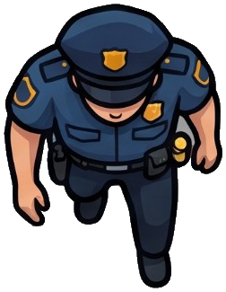
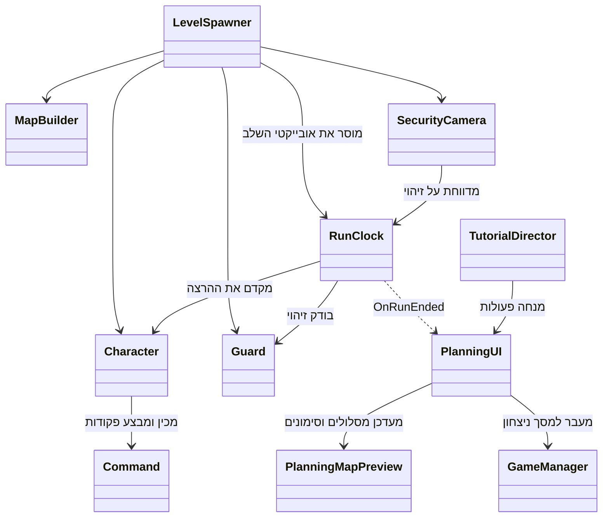

# השוד המושלם: אב טיפוס | PERFECT HEIST – Prototype

**מטלה 4** בקורס פיתוח משחקי מחשב: מימוש תהליך הליבה, פיסיקה וארכיטקטורה. ממשיך את רמת המדריך ממטלה 3.
**חברי הצוות:** כפיר נזרי, אביתר אהרון.

> **השוד מתחיל בתוכנית טובה, לא במרוץ נגד השעון.**

| | |
|---|---|
| **לשחק בדפדפן** | **[kfir-and-evyatar.itch.io/perfect-heist-prototype](https://kfir-and-evyatar.itch.io/perfect-heist-prototype)** (גם בטלפון, לרוחב) |
| **הרצה, תרשים מחלקות והחלטות ארכיטקטורה** | [מטלה 4: הרצה וארכיטקטורה](#מטלה-4--הרצה-וארכיטקטורה) (בהמשך הקובץ) |
| **תכנון הרמות של המשחק הזה** | [Level_Design.md: השוד המושלם](https://github.com/Kfir-And-Evyatar-Game-Dev/---Perfect-Heist/blob/main/Level_Design.md), עם מפות ותרשימים |
| **הגרסה של מטלה 3 (רמת המדריך)** | [itch.io](https://kfir-and-evyatar.itch.io/perfect-heist-guide-level), [סרטון מהטלפון](https://youtu.be/fIYPyt7VN1s) |

### מטלה 4: הפיסיקה בשלושת המשחקים

כל אחת מהתכונות שנלמדו מופיעה לפחות באחד מהמשחקים. **CharacterController** ממומש כאן, כי ל-`CharacterController` אין גרסה דו־ממדית ושלושת המשחקים שלנו דו־ממדיים.

| תכונה | איפה |
|---|---|
| **CharacterController** | **השוד המושלם:** המתגנב זז ב-`CharacterController.Move` מול `BoxCollider` תלת־ממדי על הקירות. אם הוא נתקע בקיר, התוכנית נכשלת ([`Character.cs`](Assets/Scripts/Actors/Character.cs), [`MapBuilder.cs`](Assets/Scripts/World/MapBuilder.cs)) |
| **Rigidbody2D** | השוד המושלם (דמויות Kinematic שזזות ב-`MovePosition` כדי שהטריגרים יזהו מגע), [כיבוש המפה](https://github.com/Kfir-And-Evyatar-Game-Dev/Map-Conquest-Prototype), [רעש שמציל](https://github.com/Kfir-And-Evyatar-Game-Dev/Sound-of-Survival-prototype) |
| **AddForce** | [כיבוש המפה](https://github.com/Kfir-And-Evyatar-Game-Dev/Map-Conquest-Prototype): שיגור פגזים והדיפה |
| **Raycast** | [כיבוש המפה](https://github.com/Kfir-And-Evyatar-Game-Dev/Map-Conquest-Prototype): בחירת יחידה ואזור בעכבר |
| **Collision2D** | [כיבוש המפה](https://github.com/Kfir-And-Evyatar-Game-Dev/Map-Conquest-Prototype), [רעש שמציל](https://github.com/Kfir-And-Evyatar-Game-Dev/Sound-of-Survival-prototype) |

### הריפוזיטוריז של המשחקים
| משחק | אב טיפוס (מטלה 4) | תכנון (מטלות 1–3) |
|---|---|---|
| השוד המושלם | הריפו הזה | [---Perfect-Heist](https://github.com/Kfir-And-Evyatar-Game-Dev/---Perfect-Heist) |
| כיבוש המפה | [Map-Conquest-Prototype](https://github.com/Kfir-And-Evyatar-Game-Dev/Map-Conquest-Prototype) | [---Map-Conquest](https://github.com/Kfir-And-Evyatar-Game-Dev/---Map-Conquest) |
| רעש שמציל | [Sound-of-Survival-prototype](https://github.com/Kfir-And-Evyatar-Game-Dev/Sound-of-Survival-prototype) | [---sound-of-survival](https://github.com/Kfir-And-Evyatar-Game-Dev/---sound-of-survival) |

---

## על המשחק

"השוד המושלם" הוא משחק תכנון דו־ממדי במבט מלמעלה. בוחרים צוות שודדים, נותנים לכל דמות פקודות על **ציר זמן**, ורק כשהתוכנית מוכנה לוחצים **RUN** וצופים בדמויות מבצעות אותה לבד. **אין הגבלת זמן לתכנון.** אם השוד נכשל, מקבלים הסבר מה השתבש, והתוכנית נשמרת כדי לתקן אותה.

בריפו הזה ממומשת **רמת המדריך**. היא מלמדת את המשחק צעד אחר צעד, ברמת פירוט שמתאימה גם למי שלא שיחק אף פעם: בכל צעד מסומן בהילה הדבר היחיד שאפשר ללחוץ עליו, עם הסבר קצר מה לעשות.

   

## מהלך המשחק

1. **דף הבית:** בוחרים שוד. המדריך פתוח, ושאר השודים (חנות תכשיטים, מוזיאון, בנק) נעולים.
2. **בחירת צוות:** חמש דמויות. לחיצה על דמות מציגה את היכולות שלה. במדריך בוחרים את **ההאקר** ואת **המתגנב**. שאר הדמויות מוצגות כצלליות נעולות.
3. **מפת התכנון:** רואים את השומר ואת מסלול הסיור שלו, את המצלמה ואת טווח הראייה שלה, את היהלום ואת רכב המילוט.
   - **לחיצה על דמות** פותחת את חלון ציר הזמן שלה, עם הפעולות שלה בלבד: הליכה, המתנה והרמה לכולם, ו־**כיבוי מצלמה** להאקר בלבד.
   - **ציר הזמן** מציג גם את השורות של שאר הדמויות, כדי לתאם תזמון.
4. **RUN:** הדמויות מבצעות את התוכנית. מי שמסיים את התוכנית ליד הרכב נכנס אליו, ואחרי שכולם בפנים עם היהלום הרכב נוסע ממסך המפה.
5. **סיום:**
   - **הצלחה:** עוברים למסך ניצחון, עם זמן ההרצה ומספר הניסיונות.
   - **כישלון:** חלון "Attempt failed" עם הסיבה, למשל "Sneak was seen by the guard at second 13.0", וחזרה לתכנון.

**שליטה:** לחיצה או הקשה בלבד, אותו קוד לעכבר ולמגע. המשחק מוצג לרוחב (Landscape).

---

## מטלה 3: ארבעת הנושאים, ואיפה הם בקוד

### 1. דגמים (Prefabs) ויצירה אוטומטית (Spawn), כולל דגמים מבינה מלאכותית
- **5 Prefabs** בתיקייה `Assets/Prefabs`: ‏Character, ‏Guard, ‏SecurityCamera, ‏Diamond ו־Exit (רכב המילוט).
- **[`LevelSpawner.cs`](Assets/Scripts/World/LevelSpawner.cs)** קורא את המפה, שכתובה כטקסט באותה צורה כמו במסמך התכנון, ויוצר עותק של ה־Prefab המתאים לכל תו עם `Instantiate`:

  | תו | נוצר |
  |---|---|
  | `&` | מצלמה |
  | `1` | שומר |
  | `$` | יהלום |
  | `X` | רכב מילוט |
  | `P` | הצוות שנבחר |

- **דגמים מ־AI:** את הדמויות, השומר, המצלמה, היהלום והרכב יצרנו ב־**Gemini**. הסרנו את הרקע וחתכנו כל אחד לקובץ PNG שקוף.
- גם המפה עצמה נבנית מקוד: [`MapBuilder.cs`](Assets/Scripts/World/MapBuilder.cs) מצייר רצפה וקירות דקים מאותה טבלת טקסט.

### 2. התנגשויות (דו־ממד)
- **דמויות:** ‏`Rigidbody2D` מסוג Kinematic ו־`CircleCollider2D`. הן זזות עם `MovePosition`, כדי שהפיזיקה תזהה מגע.
- **Triggers:**

  | אובייקט | מה קורה במגע | קוד |
  |---|---|---|
  | **מצלמה** | ‏`OnTriggerStay2D`: דמות בתוך הטווח, כשהמצלמה פעילה, מתגלה | [`SecurityCamera.cs`](Assets/Scripts/Actors/SecurityCamera.cs) |
  | **יהלום** | הדמות יודעת שהיא עומדת עליו ויכולה להרים אותו | [`Character.cs`](Assets/Scripts/Actors/Character.cs), [`Diamond.cs`](Assets/Scripts/World/Diamond.cs) |
  | **רכב המילוט** | דמות שסיימה את התוכנית בתוך הטריגר נכנסת לרכב תוך חצי שנייה, ואחר כך הרכב נוסע | [`ExitZone.cs`](Assets/Scripts/World/ExitZone.cs) |

- **השומר:** רואה 3 משבצות קדימה בזווית של 90°, ולא רואה דרך קירות ([`Guard.cs`](Assets/Scripts/Actors/Guard.cs)).

### 3. ניהול רמות ושמירת ערכי משתנים
- **[`GameManager.cs`](Assets/Scripts/Game/GameManager.cs):** ‏**Singleton** עם **`DontDestroyOnLoad`**. הוא עובר בין הסצנות ושומר את השוד שנבחר, את הצוות, את מספר הניסיונות ואת זמן ההרצה. גם "המדריך הושלם" נשמר במכשיר עם `PlayerPrefs`.
- **ארבע סצנות:** ‏`MainMenu`, ‏`TeamSelect`, ‏`Tutorial` ו־`Win`.
- **מסך ניצחון** ([`WinScreen.cs`](Assets/Scripts/UI/WinScreen.cs)) מציג את הערכים שנשמרו ב־GameManager.
- **חלון כישלון** מחזיר לתכנון, והתוכנית נשמרת.

### 4. התאמה לטלפונים ניידים
- **מסך לרוחב בלבד.**
- **אותו קוד לעכבר ולמגע:** אירועי UI, בלי מקשים.
- **כפתורים גדולים:** ממשק בקנה מידה של 1920×1080 שמתאים את עצמו לכל מסך.
- **[`CameraFit.cs`](Assets/Scripts/UI/CameraFit.cs)** מתאים את הזום של המצלמה כך שהמפה נכנסת לכל יחס מסך.
- **בנייה ל־WebGL** (itch.io, בדפדפן של הטלפון) **ול־Android** (APK).

---

## מבנה הקוד

| קובץ | תפקיד |
|---|---|
| `RunClock.cs` | שעון ההרצה **הדטרמיניסטי**: אותה תוכנית תמיד נותנת אותה תוצאה. מחליט על הצלחה או כישלון |
| `Commands.cs` | פקודות ציר הזמן: הליכה (מסלול BFS מסביב לקירות), המתנה, כיבוי מצלמה והרמה |
| `PlanningUI.cs` | מסך התכנון: לחיצה על דמות, חלון ציר הזמן, כפתורי הפעולות וחלון הכישלון |
| `TutorialDirector.cs` | שלבי המדריך במפה (כ־40 צעדים) |
| `GuideOverlay.cs`, `GuideRunner.cs` | מערכת ההדרכה: החשכה, הילה, חץ, בועת טקסט, וחסימת לחיצות מחוץ להילה |
| `MainMenuScreen.cs`, `TeamSelectScreen.cs`, `WinScreen.cs` | המסכים. הממשק נבנה בקוד, ונוצר אוטומטית עם `ScreenBootstrap.cs` |
| `UIKit.cs`, `CharacterCatalog.cs` | עזרים לבניית ממשק, ונתוני הדמויות |

---

## עזרה וכלי בינה מלאכותית

| כלי | למה השתמשנו בו |
|---|---|
| **Claude Code** (Anthropic) | כתיבת הקוד יחד איתנו, תכנון הארכיטקטורה (שעון הרצה דטרמיניסטי, פקודות, מערכת ההדרכה), ועיבוד התמונות: הסרת רקע מזויף וחיתוך לקבצים נפרדים |
| **Gemini** (Google) | יצירת התמונות של הדמויות, השומר, המצלמה, היהלום ורכב המילוט |

## מטלה 4 — הרצה וארכיטקטורה

פתחו את הפרויקט ב־Unity 6000.3.27f1, פתחו את הסצנה `Assets/Scenes/MainMenu.unity` ולחצו **Play**. בחרו במדריך והתקדמו עד לתכנון הצוות. אחרי שהמדריך מאפשר להריץ את התוכנית, אפשר לגרור על ציר הזמן לתצוגה מקדימה. לחצו **RUN** לביצוע. כישלון מחזיר לתכנון עם הפקודות שהוזנו, והצלחה מעבירה למסך הניצחון.

תיקיית `Actors` כוללת את הדמויות והאבטחה, `Game` את מצב המשחק וההרצה, `Planning` את פקודות ציר הזמן, `World` את המפה ואת העצמים בשלב, `UI` את המסכים והתצוגה המקדימה, ו־`Tutorial` את ההדרכה. התיקיות נמצאות תחת `Assets/Scripts`.

- בחרנו באירוע `OnRunEnded` במקום קריאה ישירה למסך מתוך `RunClock`. כך ההרצה מדווחת הצלחה או כישלון בלי להכיר את הממשק. `PlanningUI` מפסיק להאזין ב־`OnDisable` ונרשם מחדש כשהוא מופעל.
- שמרנו את הפקודות כטיפוסים נפרדים. החלופה הייתה מחלקה אחת עם תנאי לכל סוג פעולה. לכל פקודה יש חישוב משך וביצוע משלה, וציר הזמן משתמש בממשק המשותף של `Command`.
- הפרדנו את ציור המסלולים והסימונים ל־`PlanningMapPreview`. כך שינוי תצוגת הסיור או סימוני המפה מרוכז במחלקה שמציירת אותם.

מהירות הליכה, זמן כניסה לרכב, מידות בקר המתגנב ומרווח הסיום ניתנים לכוונון ב־Inspector. במהלך הרצה המתגנב משתמש ב־`CharacterController.Move` מול `BoxCollider` תלת־ממדי על קירות המדריך. איסוף היהלום והמילוט מזוהים באמצעות הטריגרים הדו־ממדיים.

`GameManager.Instance` שומר צוות ותוצאות במעבר בין הסצנות. `RunClock.Instance` מאפשר למצלמות של השלב לקרוא זמן ולדווח זיהוי לאותה הרצה. הרישום הסטטי של `SecurityCamera` מאפשר לפקודת הכיבוי למצוא את המצלמה לפי משבצת. מצלמות יוצאות מהרישום כשהן מושבתות. הקטלוגים הסטטיים מרכזים את אפשרויות הצוות והשלבים, ו־`ScreenBootstrap` משתמש באירוע טעינת סצנה כדי לטעון את המסך המתאים.

כדי להוסיף שומר עם סיור שונה, עורכים את הגדרות הסיור ב־`LevelSpawner`. סוג אויב עם כללי זיהוי חדשים דורש סקריפט ו־Prefab משלו וחיבור למנגנון הדיווח של `RunClock`. כך מסך הכישלון יכול לקבל את אותה הודעה דרך האירוע הקיים. לחפץ חדש מוסיפים Prefab וסימון במפה, ומעדכנים את יצירתו ב־`LevelSpawner`. אם החפץ נדרש לניצחון, מעדכנים גם את כלל הניצחון ב־`RunClock`.

### בדיקת התאמה בין התרשים לקוד

המימוש מרחיב את התרשים הראשוני במחלקת `PlanningMapPreview`, שאליה הועבר ציור המסלולים והסימונים מתוך `PlanningUI`. התרשים שלמעלה מתעד את החיבור החדש ואת האירוע שהממשק מקבל בסיום הרצה.
